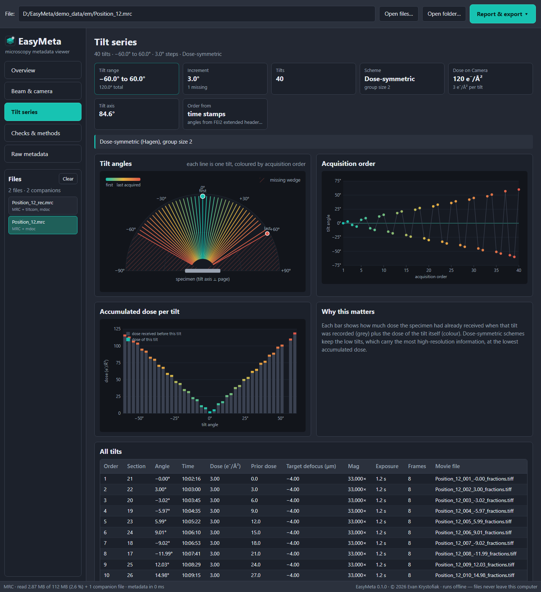

# EasyMeta

**Microscopy metadata at a glance, for light and electron microscopy.** Drop an
image file (or a whole folder) on EasyMeta and it shows the microscope, the
optics, the acquisition settings and the geometry of the data. It works out
whether the file is light or electron microscopy and shows the pages that fit:

- **Light microscopy:** the objective; a wavelength map of each channel showing
  the dye's excitation/emission peaks, the laser lines or LEDs used, and the
  detection windows; detectors, pinhole and scan settings; the stack drawn to
  scale in 3D; Nyquist sampling. For a Zeiss LSM it also shows whether Airyscan
  was used, in which mode, and whether the file is raw or processed Airyscan
  data.
- **Electron microscopy:** kV, magnification, illumination (spot, illuminated
  area, probe mode, C2 aperture), energy filter, detector mode, dose and dose
  rate.
  - **Tilt series:** the tilt range, step, the scheme it detects (dose-symmetric,
    bidirectional, unidirectional), the acquisition order and the accumulated
    dose per tilt, all drawn as graphics.
  - **Tomograms:** dimensions, voxel size, thickness, binning and processing
    history, with a to-scale 3D volume showing the central slice.

EasyMeta runs **offline in a web browser**, with nothing to install. It reads
only the header and metadata blocks it needs: usually a few KB, even from
multi-GB files. A small preview reads one plane at most. **Files never leave
the computer.**



## Documentation

| Document | Contents |
|---|---|
| [Quick start](docs/QUICK_START.md) | Open your first file in two minutes. |
| [User guide](docs/USER_GUIDE.md) | Every page, graphic and button, with screenshots. |
| [Supported formats](docs/FORMATS.md) | What is read from each format; how companion files are paired. |
| [Checks and calculations](docs/CHECKS.md) | The rule and threshold behind every check and estimate. |
| [Reports and exports](docs/EXPORTS.md) | The report, and the JSON and CSV exports. |
| [Facility setup](docs/FACILITY_SETUP.md) | Installing on shared computers and naming your instruments. |
| [Troubleshooting](docs/TROUBLESHOOTING.md) | Common problems and known limitations. |
| [Developer guide](docs/DEVELOPER.md) | Adding a format, a check or a graphic. |

See [`CHANGELOG.md`](CHANGELOG.md) for the version history.

## Starting EasyMeta

| System | How |
|---|---|
| Windows | Double-click **`EasyMeta.exe`**. It opens EasyMeta in its own Edge or Chrome window. If the exe is blocked, use `EasyMeta.bat`, or open `EasyMeta.html` directly. |
| macOS / Linux | Open **`EasyMeta.html`** in Chrome, Edge, Firefox or Safari (double-click it, or drag it onto the browser). |
| Any computer | Copy the whole `EasyMeta` folder. It needs no internet connection, server or Python. |

## Using it

1. **Open files…**, **Open folder…**, or drag files or folders onto the window.
   Dropped files always work. Edge and Chrome do not let a page opened from
   disk read a *dropped folder*; if that happens EasyMeta says so, and
   **Open folder…** reads the same folder.
2. Companion files are paired automatically **when they are opened together**
   with the image (same folder or same drop):
   - `.mdoc` (SerialEM / Thermo Tomography): per-tilt angle, dose, time and
     defocus. For a Tomo5 or SerialEM *frame movie*, the mdoc shows which tilt
     of which series the movie is.
   - EPU/Tomo `.xml` beside an `.mrc`/`.tiff`/`.eer`: full microscope state,
     including C2 aperture and dose.
   - IMOD `.tlt` / `.rawtlt` and `tilt.com`: tilt angles and reconstruction
     settings for stacks and tomograms.
3. Use the pages on the left (Overview, Optics & channels, Stack, Beam & camera,
   Tilt series, Volume, Frames, Checks & methods, Raw metadata). Multi-image
   files (e.g. Leica LIF projects) get an image picker on the Overview page.
4. **Report & export** (top right) offers:
   - a printable one-page report (choose *Save as PDF* in the print dialog);
   - a standalone HTML report;
   - all metadata as JSON, or a summary CSV;
   - the machine-generated methods paragraph, copied to the clipboard.

For a plain ImageJ/TIFF file EasyMeta guesses the modality; you can switch it
on the Overview page.

### What the checks and graphics mean

- **Checks** are rules of thumb applied to the metadata (no pixels are
  analysed). Examples: pixel size vs. the optical resolution (Nyquist), Z-step
  vs. axial resolution, overlapping detection windows, a dye whose emission
  peak lies outside its detection window, bleed-through between channels
  recorded together (from measured spectra), truncated MRC files, missing tilts,
  dose on camera, dose rate on counting detectors, and pixel sizes that disagree
  between sources.
- **Resolution estimates** use 0.51·λ/NA (lateral) and 0.88·λ/(n−√(n²−NA²))
  (axial), with Nyquist = resolution / 2.3.
- **Dye spectra** in the wavelength map are measured spectra from
  [FPbase](https://www.fpbase.org) for 80 common dyes and fluorescent proteins.
  The dashed line is excitation (dotted where FPbase has only absorption) and
  the filled curve is emission. They are drawn over the laser lines and
  detection windows recorded in the file.
- **Dye peaks (○/●)** come from those spectra, or from EasyMeta's list of
  published peaks (`js/analysis/dyes.js`) for dyes without one. Dyes EasyMeta
  does not know are drawn at the wavelengths stored in the file (marked ‡). The
  file's own stored values are always listed in the channel table. Nothing is
  estimated.
- **Channel colours** are the display colours stored in the file. A white or
  grey fluorescence channel (ZEN's default for a dye it does not know) is drawn
  in its emission colour instead; far-red and near-infrared channels (650 nm
  and up) are drawn reddish purple.
- **Zeiss LSM model:** the Axio Imager / Axio Observer / Examiner named in a
  CZI is the stand. EasyMeta names the LSM scan head from the hardware
  configuration and scaling stored in the file. It does not use the
  Microscope "System" field, which ZEN 3.x fills with "LSM 800" on LSM 980
  systems too; a note on the Checks page shows when the two disagree.
- **Imaris files converted from another format:** the microscope and settings
  come from the original metadata the converter kept, when it kept them. Zeiss
  and Nikon conversions give the system, lasers and detectors; Olympus and older
  Zeiss LSM files give the system and laser lines. Leica conversions keep no
  system name, so they show only "Leica". The header line shows the source
  format (e.g. "from Zeiss: CZI").
- **EM camera port:** Thermo's microscope software names the camera behind the
  energy filter "EF-CCD" (and the bottom-mount one "BM-CCD") whatever camera
  it is. For a direct electron detector (K2, K3, Falcon, DE…) EasyMeta shows
  the port as "EF-DE" / "BM-DE"; Raw metadata keeps the file's own name.
- The **methods paragraph** is labelled *(Machine Generated)*: it is built only
  from values in the file. Check it before use.

## Supported formats

| Format | Vendor / software | Status |
|---|---|---|
| CZI | Zeiss ZEN (blue and black) | tested (LSM 980 with Airyscan, raw and processed; LSM 980 confocal on an Axio Imager.Z2 with spectral and NIR detectors; LSM 710); embedded thumbnail |
| LSM | Zeiss ZEN black / AIM | tested |
| ND2 (v3 chunk format) | Nikon NIS-Elements | tested (Ti spinning disk, TIRF); legacy JPEG2000 ND2 not supported |
| LIF | Leica LAS X / LAS AF | tested (Stellaris 5: sequential settings, Lightning-deconvolved images, TauGating/TauContrast lifetime channels; image picker for the 14 images) |
| OIB / OIF | Olympus FluoView | OIB tested (FV1000); OIF untested |
| IMS | Bitplane Imaris (HDF5) | tested (Imaris 5 to 9.9; conversions from Zeiss CZI, LSM and ZVI, Nikon ND2, Leica LIF and Olympus OIB) |
| OME-TIFF, ImageJ TIFF | Bio-Formats, Fiji, Micro-Manager… | ImageJ tested; OME-TIFF untested |
| MRC / MRCS / ST / ALI / REC / MAP | any; Thermo FEI1/FEI2 and SerialEM extended headers | tested (Tomo5 Krios series, IMOD tomograms, SerialEM, EPU) |
| EER | Thermo Falcon 4/4i | tested (metadata; no preview, since frames are single-electron events) |
| DM3 / DM4 | Gatan DigitalMicrograph | tested (K2, K3 gain reference, Orius) |
| EPU / Tomo XML | Thermo Fisher | tested (Glacios grid square) |
| AMT camera TIFF | AMT Image Capture | tested (positional fields are listed line by line in Raw metadata) |
| Zeiss SmartSEM TIFF, Thermo SEM/FIB TIFF, Fibics Atlas | Zeiss, Thermo Fisher, Fibics | implemented, untested (no original files found here) |
| `.mdoc`, `.tlt`, `.rawtlt`, `tilt.com` | SerialEM, Tomography, IMOD | tested |

Not yet supported: Leica LOF/XLIF, Olympus OIR/VSI, Thermo Velox EMD, FEI TIA
SER/EMI. Each can be added as one file (see below).

## Fluorophore spectra: credits and license

The measured spectra in `js/data/spectra_fpbase.js` come from **FPbase**:

> Lambert TJ (2019) FPbase: a community-editable fluorescent protein database.
> Nat Methods 16:277–278, doi:10.1038/s41592-019-0352-8.

They are used under the FPbase data policy (https://www.fpbase.org/terms/).
The data file is redistributed under **CC BY-SA 4.0**
(https://creativecommons.org/licenses/by-sa/4.0/); the rest of EasyMeta is not
affected by that license. The only changes are resampling to 2 nm,
peak-normalising and trimming near-zero tails.

[`SPECTRA_CREDITS.md`](SPECTRA_CREDITS.md) lists the original authors or
supplier and the FPbase spectrum ids for every curve. Many dye spectra on
FPbase come from the dye suppliers, and FPbase notes that some data may carry
third-party rights. Dye names are trademarks of their owners. DyLight 594 is
not on FPbase and is shown with its peaks only.

To refresh the spectra (needs internet once; the app itself never goes online):

```
python tools/fetch_fpbase_spectra.py tools/fpbase_spectrum_ids.csv <download folder>
python tools/build_spectra.py tools/fpbase_spectrum_ids.csv <download folder> .
```

## Facility instrument names

Files often name a microscope only by a system ID (e.g. `TITAN12345678`,
D-number 1234) or a plugin name. Edit **`config/instruments.js`** to map those
to the names users should see. The system IDs in that file are made-up
examples; put in those of your own instruments.

## For developers

```
EasyMeta.html          the app (plain scripts, so it also runs from file://)
css/easymeta.css       look and feel (pyPrep / pyFIB dark theme)
config/instruments.js  facility instrument names
js/core/               file access (Range reads + block cache), TIFF, OLE2, HDF5, XML/INI, previews
js/formats/            one file per format (or group of formats)
js/analysis/           derived values, tilt scheme detection, checks, methods text, dye peaks, spectra lookup
js/data/               bundled data: spectra_fpbase.js (FPbase spectra, CC BY-SA 4.0)
js/views/              pages, SVG graphics, raw metadata tree, report & export
js/app.js              controller (open / drop / navigation / status)
launcher/              EasyMeta.cs + build_launcher.bat -> EasyMeta.exe (built-in .NET compiler)
tools/devserver.py     development server for automated testing (not needed to use the app)
tools/make_icon.py     packs the PNG renders of img/easymeta.svg into the .ico
tools/fetch_fpbase_spectra.py, build_spectra.py, fpbase_spectrum_ids.csv
                       one-time download + packing of the FPbase spectra
docs/                  user guide and reference documents (start at docs/README.md)
```

**Adding a format:** create `js/formats/<name>.js` and add a `<script>` tag
for it in `EasyMeta.html`. The file should call one of:

- `EasyMeta.registerFormat({id, name, modality, extensions, sniff(head, ext), parse(src, ctx)})`
- `EasyMeta.registerTiffFlavor({...})`, for a TIFF variant
- `EasyMeta.registerCompanion({...})`, for a side-car file

`parse` reads bytes with `src.read(offset, length)` and fills a dataset made
by `EasyMeta.newDataset()`. All lengths are in metres, voltages in volts and
doses in e⁻/Ų. The pages, checks, methods text and report read only that
dataset, so a new format gets them all for free.

**Testing with real files:** run `python tools/devserver.py 8765` and open
`http://127.0.0.1:8765/EasyMeta.html?open=/fs/<url-encoded path>` (repeat
`open=` for companions). The server serves local files with HTTP Range, so the
app reads them exactly as it reads dropped files.

**Rebuilding the launcher:** run `launcher\build_launcher.bat`.

## License

EasyMeta is released under the [MIT License](LICENSE).
Copyright © 2026 Evan Krystofiak.

You may use, copy, modify and redistribute it, including in other software,
as long as the copyright notice and the license text stay with it.

The MIT License does not cover the FPbase spectra in
`js/data/spectra_fpbase.js`. They keep their own license (CC BY-SA 4.0, see
*Fluorophore spectra: credits and license* above).
