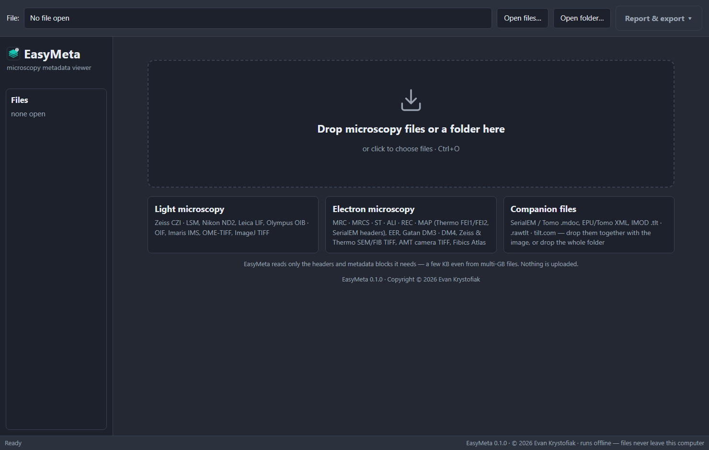
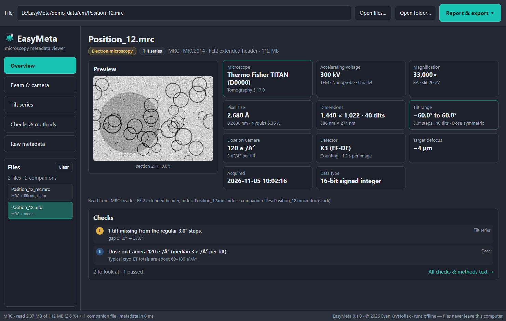

# Quick start

## 1. Get EasyMeta

Download the whole `EasyMeta` folder. From GitHub: **Code → Download ZIP**,
then unzip it. Keep the folder together: `EasyMeta.html` needs the `js`, `css`,
`img` and `config` folders next to it.

There is nothing to install. EasyMeta needs no internet connection, no server
and no Python.

## 2. Start it

| System | Do this |
|---|---|
| Windows | Double-click **`EasyMeta.exe`**. It opens EasyMeta in its own Edge or Chrome window. |
| macOS, Linux | Open **`EasyMeta.html`** in Chrome, Edge, Firefox or Safari. |

If Windows blocks the `.exe`, double-click `EasyMeta.bat` instead, or open
`EasyMeta.html` in your browser. All three start the same program.

## 3. Open your data

Use any of these:

- Drag files onto the window.
- Click **Open files…** (or press `Ctrl+O`).
- Click **Open folder…** to open a whole session folder at once.

Open companion files **together with the image**: the `.mdoc` of a tilt
series, the EPU `.xml` of an image, IMOD's `.tlt` and `tilt.com`. EasyMeta
pairs them by name. The simplest way is to open the folder that holds them.

## 4. Read the pages

EasyMeta decides whether the file is light or electron microscopy and shows
the pages that fit. They are listed on the left.

| Page | Shows |
|---|---|
| Overview | A preview, the key facts and the checks that need a look. |
| Optics & channels *(light)* | Objective, microscope, a wavelength map of every channel, the channel table. |
| Stack *(light)* | The stack drawn to scale, and whether the sampling meets Nyquist. |
| Beam & camera *(electron)* | Voltage, magnification, illumination, energy filter, detector and dose. |
| Tilt series *(electron)* | Tilt range, scheme, acquisition order and accumulated dose. |
| Volume *(electron)* | Tomogram size, voxel size, thickness, binning and processing history. |
| Checks & methods | Every check, and a draft methods paragraph. |
| Raw metadata | Everything EasyMeta read, as stored, with a search box. |

## 5. Save what you need

**Report & export** (top right) gives you a printable report, an HTML report,
all metadata as JSON, a summary CSV, or the methods paragraph on the clipboard.

## Good to know

- EasyMeta reads only headers and metadata: usually a few KB, even from a
  multi-GB file. The status bar at the bottom shows how much it read.
- Your files stay on your computer. EasyMeta makes no network requests.
- The checks are rules of thumb applied to the metadata. EasyMeta does not
  analyse the pixels.
- The methods paragraph is machine generated. Check it before you use it.

Next: the [user guide](USER_GUIDE.md) explains every page.
