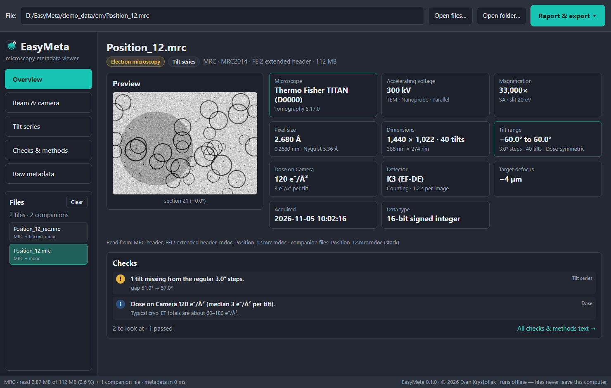
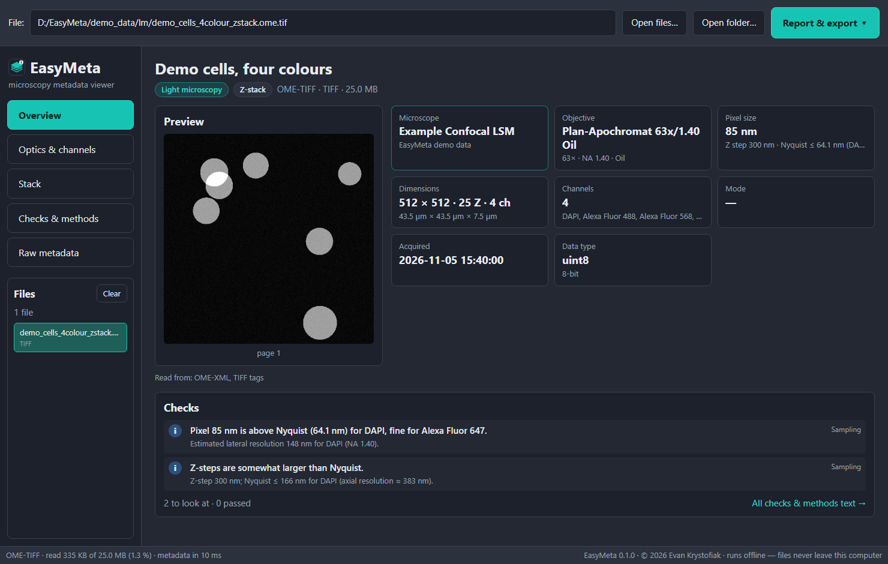
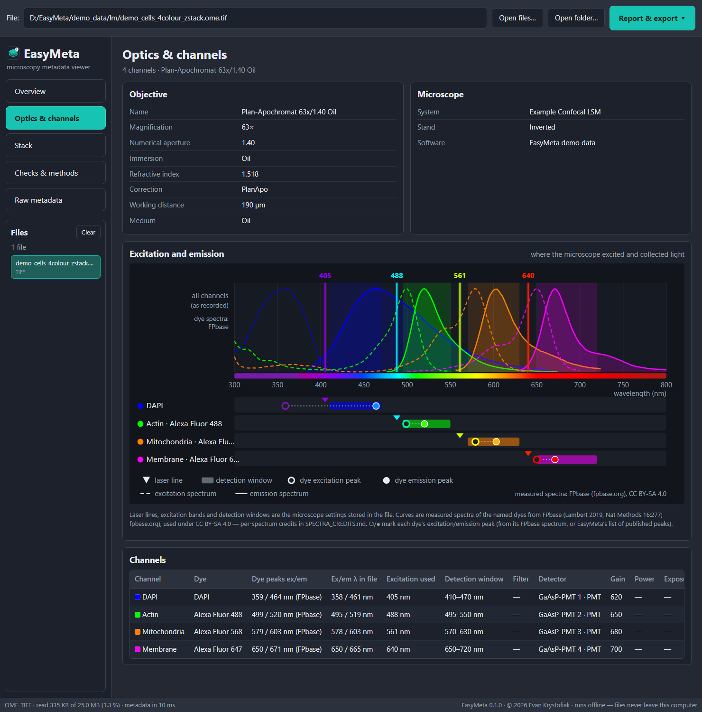
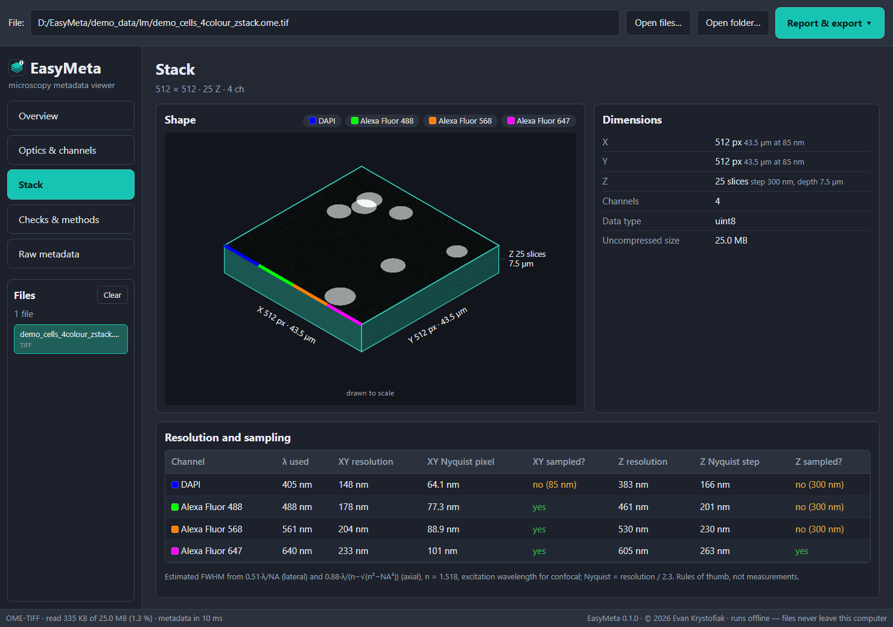
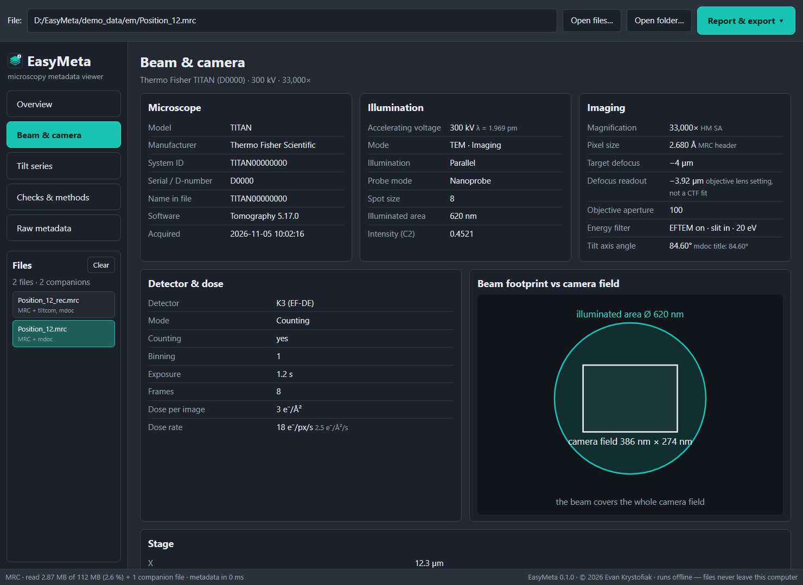
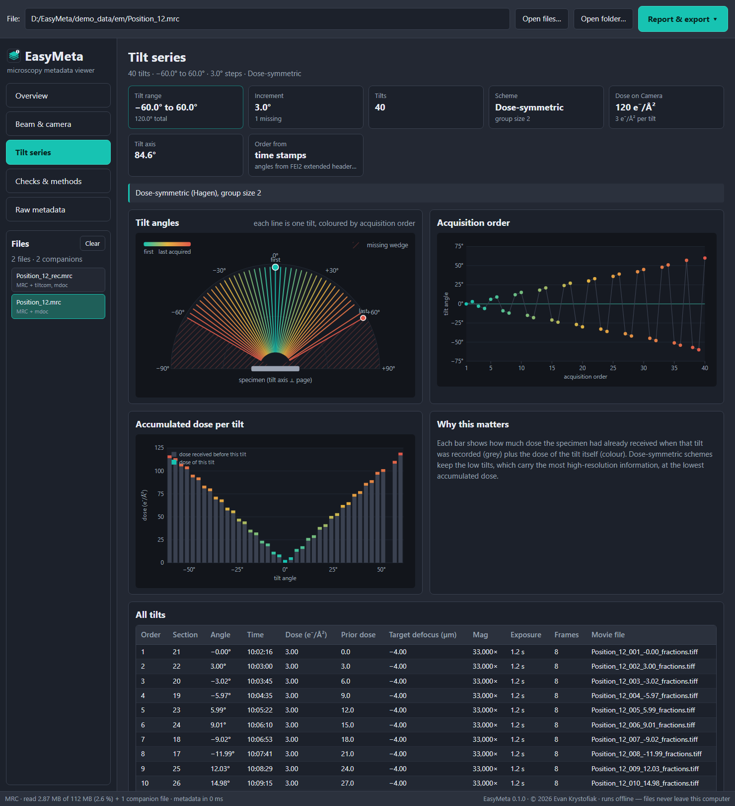
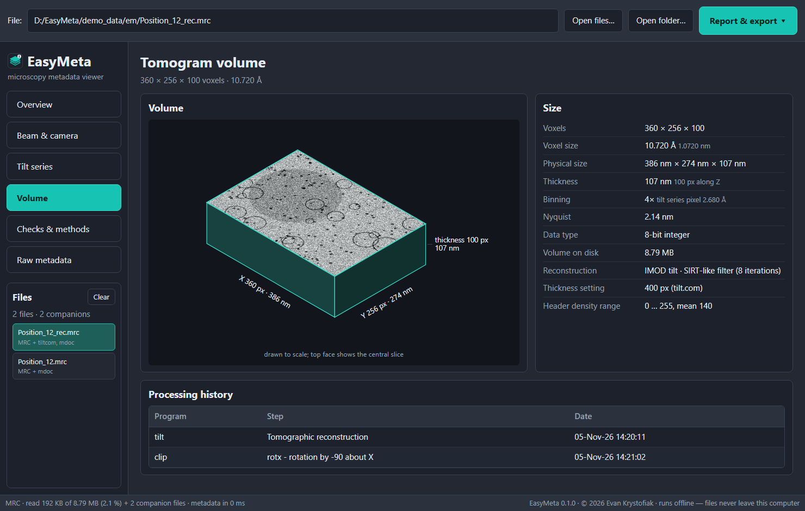
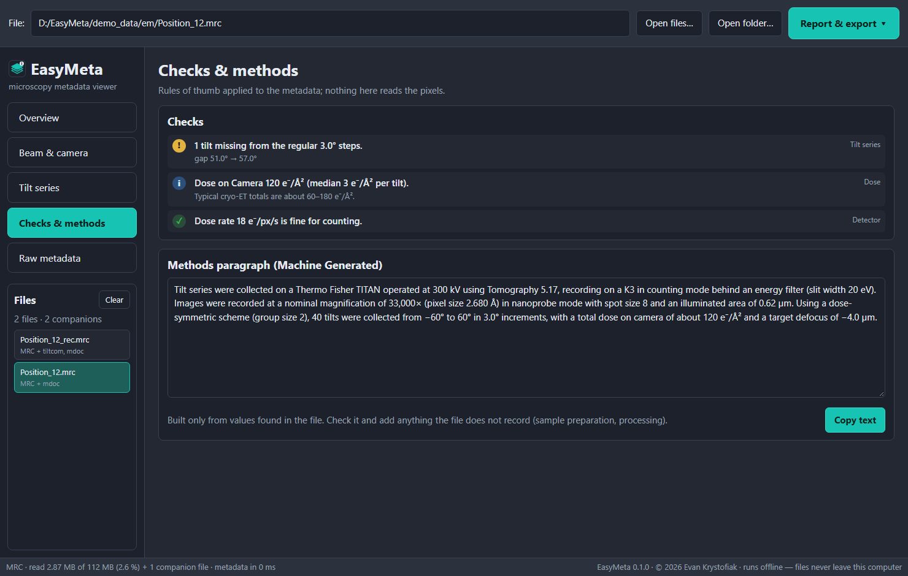
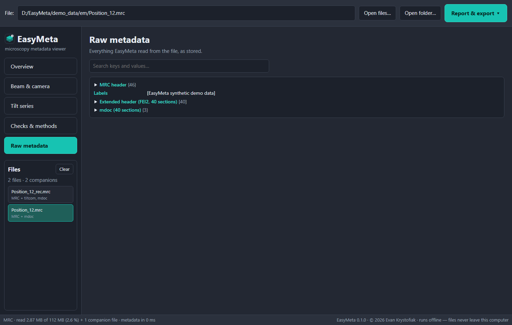

# EasyMeta user guide

EasyMeta 0.1.0

**Contents**

1. [What EasyMeta does](#1-what-easymeta-does)
2. [Starting EasyMeta](#2-starting-easymeta)
3. [The window](#3-the-window)
4. [Opening files](#4-opening-files)
5. [Companion files](#5-companion-files)
6. [Overview page](#6-overview-page)
7. [Light microscopy pages](#7-light-microscopy-pages)
8. [Electron microscopy pages](#8-electron-microscopy-pages)
9. [Checks & methods page](#9-checks--methods-page)
10. [Raw metadata page](#10-raw-metadata-page)
11. [Report & export](#11-report--export)
12. [Worked examples](#12-worked-examples)
13. [Limits to keep in mind](#13-limits-to-keep-in-mind)

---

## 1. What EasyMeta does

Drop a microscopy file on EasyMeta and it shows how the data was recorded: the
microscope, the optics, the acquisition settings and the geometry. It works
out whether the file is light microscopy (LM) or electron microscopy (EM) and
shows the pages that fit.

Three things define how it works:

- **It reads metadata only.** EasyMeta reads the header and metadata blocks of
  a file, usually a few KB even from a multi-GB file. For the preview it reads
  one image plane at most. It never loads the whole file.
- **It runs offline.** EasyMeta is a web page that runs from your disk. It
  makes no network requests, and your files never leave the computer.
- **It reports what the file says.** Values are shown as the acquisition
  software recorded them. Where EasyMeta derives or infers a value, the page
  says so.

EasyMeta is not an image viewer and does not analyse pixels. Use it to check
how a dataset was acquired, to compare sessions, to catch a wrong setting
before processing, and to draft a methods paragraph.

## 2. Starting EasyMeta

Keep the whole `EasyMeta` folder together, then:

| System | Start with |
|---|---|
| Windows | `EasyMeta.exe`: opens EasyMeta in its own Edge or Chrome window, without tabs or an address bar. |
| Windows, if the `.exe` is blocked | `EasyMeta.bat` (same window, Edge only), or open `EasyMeta.html` in a browser. |
| macOS, Linux | Open `EasyMeta.html` in Chrome, Edge, Firefox or Safari. |

The launcher only opens `EasyMeta.html` in a browser window. The program is
the same whichever way you start it. If the launcher cannot find Edge or
Chrome, it opens the page in your default browser.

## 3. The window

| Area | What it holds |
|---|---|
| Top bar | **File:** the path of the open file. **Open files…**, **Open folder…**, and **Report & export**, which is active once a file is open. |
| Left: pages | One button per page. The list changes with the kind of file. |
| Left: Files | Every file open in this session. Click one to show it. **Clear** closes them all. |
| Centre | The current page. |
| Status bar | Left: the format, how many bytes EasyMeta read out of the file size, how many companion files it used, and the time it took. Right: the version. |

In the **Files** list, each entry shows the file name, its format and the
companion files paired with it, for example `MRC + mdoc`. When more than 12
files are open, a filter box appears above the list. The list draws the first
1,000 files; use the filter to reach the rest.

## 4. Opening files

There are three ways to open data:

1. **Drag** files or folders onto the window.
2. **Open files…** (or `Ctrl+O`; `Cmd+O` on macOS) to choose one or more files.
3. **Open folder…** to choose a folder. EasyMeta checks every file in it,
   including sub-folders.

Each new batch is added to the files already open. EasyMeta shows the first
new file it recognises. Files it does not recognise are skipped and counted in
the status bar, for example `3 files recognised · 12 other files skipped`. A
file that is already open is not added twice.

**Dropped folders in Edge and Chrome.** These browsers do not let a page opened
from disk read a dropped *folder*. EasyMeta tells you when that happens. Use
**Open folder…** for the same folder, or drop the files themselves. Dropped
files always work.

**Files with several images.** A Leica LIF project or a multi-image OME-TIFF
holds several images. EasyMeta shows an image picker at the top of the Overview
page; every page then describes the image you picked.

## 5. Companion files

Some metadata lives in a separate file next to the image. EasyMeta pairs a
companion with its image when both are **opened together and sit in the same
folder**. Opening the folder is the simplest way to get this right.

| Companion | Written by | Adds |
|---|---|---|
| `.mdoc` | SerialEM, Thermo Tomography | Per-tilt angle, time, dose, prior dose, defocus, frame count and movie file name. For a single frame movie, which tilt of which series it is. |
| EPU / Tomo `.xml` | Thermo Fisher EPU and Tomography | The full microscope state for one image, including C2 aperture and dose. |
| `.tlt`, `.rawtlt` | IMOD | Tilt angles for a stack. |
| `tilt.com` | IMOD / etomo | Reconstruction settings for a tomogram: thickness, binning, filter. |

A paired companion appears in three places: as a tag in the Files list, on the
**Read from** line of the Overview page, and in the status bar.

An `.mdoc` or an EPU `.xml` opened **without** its image is shown on its own as
a metadata-only entry. This is useful when the image is too far away to copy:
the `.mdoc` alone gives the full Tilt series page.

[Supported formats](FORMATS.md#how-companion-files-are-paired) lists the exact
naming rules.

## 6. Overview page

The Overview is the first page for every file.

- **Title line.** The file name, a badge for light or electron microscopy, a
  badge for the kind of data (single image, Z-stack, tilt series, tomogram,
  movie, montage and so on), the format and the file size.
- **Preview.** A small picture of one plane, with a note saying which one: the
  tilt nearest 0° for a tilt series, the central slice for a tomogram, the
  embedded thumbnail where the format has one. Some files have no cheap
  preview. Falcon EER frames, for example, hold single electron events and are
  not decoded.
- **Key facts.** Tiles with the values people ask for first. The set depends
  on the kind of file; see the lists below.
- **Read from.** The metadata sources used (for example `MRC header, FEI2
  extended header, mdoc`) and the companion files.
- **Checks.** Up to five checks that need a look, with a link to the full list.
- **Light / electron switch.** Shown for a plain TIFF when EasyMeta cannot tell
  what it is. Pick one and the pages change to match.

Key facts for **light microscopy**: microscope and software, objective (name,
magnification, NA, immersion), pixel size with the Z step and whether it meets
Nyquist, dimensions and physical size, channels, acquisition mode with pinhole
and zoom, Airyscan use (Zeiss LSM only), time-lapse interval, acquisition date
and data type.

Key facts for **electron microscopy**: microscope and software, accelerating
voltage with mode, magnification with the energy-filter slit, pixel or voxel
size with Nyquist, dimensions, tilt range with step and scheme, dose on
camera, detector with mode, target defocus, tomogram thickness, acquisition
date and data type. SEM and FIB images show beam, working distance, detector
and dwell time instead.

A tile shows `—` when the file does not record that value.

## 7. Light microscopy pages

### Optics & channels

**Objective** and **Microscope** list what the file records: objective name,
magnification, NA, immersion and refractive index; the system, stand, mode,
pinhole, scan zoom, pixel dwell, averaging and software.

**Excitation and emission** is a wavelength map. It answers one question:
where did the microscope excite, and where did it collect light?

| Mark | Meaning |
|---|---|
| Vertical line with a number | A laser line or LED used, in nm. |
| Shaded band | A detection window recorded in the file. |
| Dashed curve | The dye's excitation spectrum. Dotted where only an absorption spectrum exists. |
| Filled curve | The dye's emission spectrum. |
| ○ and ● | The dye's excitation and emission peak. |
| ▼ in a channel row | The laser line used for that channel. |
| Bar in a channel row | That channel's detection window. |
| ‡ after a dye name | EasyMeta does not know this dye. Its marks are drawn at the wavelengths stored in the file. |

The top panel overlays all channels. Below it, each channel has its own row.
A well-matched channel has its laser line near the excitation peak and its
emission peak inside the detection window.

The spectra are measured curves from [FPbase](https://www.fpbase.org) for 80
common dyes and fluorescent proteins. For a known dye without a bundled
spectrum, EasyMeta uses its list of published peaks. Nothing is estimated.

**Channels** is the table behind the map. Two columns are easy to confuse:

- **Dye peaks ex/em** is the published peak of the named dye.
- **Ex/em λ in file** is what the file stores in its own wavelength fields.
  Some software fills these with the laser line or the centre of the detection
  window, so they can differ from the dye's peaks.

The other columns give the excitation used, detection window, filter,
detector, gain, laser power, exposure and pinhole for each channel.

**Channel colours** are the display colours stored in the file. A white or
grey fluorescence channel is drawn in its emission colour instead. Channels
at 650 nm and above are drawn reddish purple.

**Zeiss LSM files** get two extra items. EasyMeta names the LSM scan head from
the hardware configuration stored in the file, not from the "System" field,
which ZEN 3.x fills with "LSM 800" on LSM 980 systems too. It also reports
Airyscan: whether it was used, in which mode, and whether the file holds raw
detector data or a processed image.

### Stack (or Image size)

**Shape** draws the stack as a box to scale, with the preview on the top face
and one coloured segment per channel. The note under the box says when a
dimension is not to scale, for example when the file has no Z calibration.

**Dimensions** lists pixels and physical size for X, Y and Z, the number of
channels, time points, positions, tiles and spectral bands, the data type and
the uncompressed size.

**Resolution and sampling** compares the pixel size with the optics, per
channel:

- *XY resolution* and *Z resolution* are estimates of the optical resolution.
- *XY Nyquist pixel* and *Z Nyquist step* are the largest pixel and Z step
  that still sample that resolution.
- *XY sampled?* and *Z sampled?* say whether the data meets them. A `no` shows
  the actual pixel or step in brackets.

These are rules of thumb, not measurements. The line under the table states
the formulas and the refractive index used.
[Checks and calculations](CHECKS.md#light-microscopy-resolution-and-nyquist)
has the detail.

For a single image the page is called **Image size**. It has the same content
without the Z rows.

## 8. Electron microscopy pages

### Beam & camera

| Card | Contents |
|---|---|
| Microscope | Instrument name, model, system ID, serial or D-number, software, date, operator. |
| Illumination | Voltage and electron wavelength, mode, probe mode, spot size, illuminated area, intensity, convergence angle, C1 and C2 apertures, phase plate. |
| Imaging | Magnification, pixel size and its source, target defocus, defocus readout, objective aperture, energy filter, tilt axis angle. |
| Detector & dose | Detector and mode, counting, binning, readout area, exposure, frames, dose per image, dose rate. |
| Beam footprint vs camera field | The illuminated area drawn against the camera field, to scale. It shows at a glance whether the beam covers the camera. |
| Stage | Stage position and tilt. |

Three points help when reading this page:

- **Defocus readout** is the objective lens setting, not a CTF fit.
- **Detector "inferred from the sensor size"** means the file names only a
  generic camera. EasyMeta recognised a Gatan K2 or K3 from the image size.
- **EF-DE and BM-DE.** Thermo software names the camera behind the energy
  filter "EF-CCD" and the bottom-mount camera "BM-CCD", whatever the camera
  is. For a direct electron detector EasyMeta shows "EF-DE" or "BM-DE". The
  Raw metadata page keeps the file's own name.

For SEM and FIB images the page is called **Beam & detector** and shows beam
current, working distance, horizontal field width, detector, dwell time and
stage tilt.

### Tilt series

This page appears for every file with more than one tilt angle.

The tiles give the tilt range, the increment and how many tilts are missing,
the number of tilts, the scheme, the dose on camera, the tilt axis angle and
where the acquisition order came from.

**Scheme.** EasyMeta looks at the order in which the tilts were recorded and
names the scheme:

| Scheme | Pattern |
|---|---|
| Dose-symmetric | Starts near 0° and alternates between the two sides in groups. The group size is shown. |
| Bidirectional | Runs one way from the start angle, jumps back next to the start, then runs the other way. |
| Unidirectional | Runs from one end to the other. |
| Custom | An order that fits none of these. |

**Order from** tells you how far to trust it. *time stamps* and *.mdoc order*
are real acquisition orders. *file order (assumed)* means the file has no time
stamps, so EasyMeta assumed the stack is stored in acquisition order. Open the
`.mdoc` with the stack to get the real order.

The three graphics:

- **Tilt angles.** Each line is one tilt, coloured from first to last
  acquired. The hatched areas are the missing wedge.
- **Acquisition order.** Tilt angle against acquisition number. A
  dose-symmetric series fans out from 0° as a zigzag.
- **Accumulated dose per tilt.** For each tilt, the grey bar is the dose the
  specimen had already received and the coloured cap is the dose of the tilt
  itself. Dose-symmetric schemes keep the low tilts at the lowest accumulated
  dose.

**All tilts** lists every tilt in acquisition order: section number in the
stack, angle, time, dose, prior dose, target defocus, magnification, exposure,
frame count and movie file name.

For a **tomogram** or a **single frame movie** opened with the `.mdoc` of its
series, the same page appears as *Source tilt series* or *Tilt series this
movie belongs to*. The movie's own tilt is highlighted in the table.

### Volume (or Map)

This page appears for tomograms and 3D maps. The volume is drawn to scale with
the central slice on its top face. The **Size** card lists voxels, voxel size,
physical size, thickness, binning, Nyquist, data type and size on disk.

- **Binning** needs the tilt-series pixel size. EasyMeta gets it from the
  `.mdoc` of the series when the two are opened together.
- **Reconstruction** and **Thickness setting** come from IMOD's `tilt.com`
  when it is opened with the tomogram.
- **Processing history** lists the labels stored in the MRC header. IMOD,
  for example, writes one label per processing step.

If the thin dimension of a tomogram runs along Y (IMOD output before
rotation), EasyMeta says so, treats Y as the thickness and draws the volume
accordingly.

### Frames and Montage

A **Frames** page appears for dose-fractionated movies. It shows the number of
frames, the dose per frame, the total dose and exposure, EER details, and the
tilt series the movie belongs to.

A **Montage** page appears for SerialEM montages. It draws the layout of the
pieces.

## 9. Checks & methods page

### Checks

A check is a rule of thumb applied to the metadata. No pixels are analysed.
Each check has a level:

| Icon | Level | Meaning |
|---|---|---|
| ✖ | Error | Something is wrong with the file, for example it is truncated. |
| ! | Warning | Worth a look before you rely on the data. |
| i | Information | A fact worth knowing. Often fine. |
| ✓ | Passed | The rule was applied and met. |

The label on the right of each check names its area: File, Calibration,
Sampling, Optics, Spectra, Tilt series, Dose, Tomogram or Detector.

Light microscopy checks cover XY and Z sampling against Nyquist, the pinhole
size, a dye whose emission peak lies outside its detection window, a laser
line inside a detection window, overlapping detection windows, and
bleed-through between channels recorded together.

Electron microscopy checks cover truncated files, a pixel size that was never
set, pixel sizes that disagree between sources, missing tilts, irregular
increments, a small or asymmetric tilt range, total dose, dose rate on
counting detectors, changing magnification within a series, and large defocus.

[Checks and calculations](CHECKS.md) lists every check with its threshold.

### Methods paragraph

Below the checks is a draft methods paragraph, labelled *(Machine Generated)*.
EasyMeta builds it only from values found in the file. For the tilt series in
the screenshots it reads:

> Tilt series were collected on a Thermo Fisher TITAN operated at 300 kV using
> Tomography 5.17, recording on a K3 in counting mode behind an energy filter
> (slit width 20 eV). Images were recorded at a nominal magnification of
> 33,000× (pixel size 2.680 Å) in nanoprobe mode with spot size 8 and an
> illuminated area of 0.62 µm. Using a dose-symmetric scheme (group size 2),
> 40 tilts were collected from −60° to 60° in 3.0° increments, with a total
> dose on camera of about 120 e⁻/Ų and a target defocus of −4.0 µm.

You can edit the text in the box before you copy it. **Check it before you use
it**, and add what the file cannot know: sample preparation, grid type,
processing.

## 10. Raw metadata page

This page holds everything EasyMeta read from the file, as stored, in a
collapsible tree. Use it when a value is not on the other pages, or when you
want to see the file's own name for something.

- Type two or more characters in the **search box** to find keys and values.
- **Download** buttons appear when the file holds a whole metadata document,
  such as the CZI metadata XML, the LIF header XML or OME-XML. They save that
  document as a file.

## 11. Report & export

The **Report & export** menu (top right) acts on the file and image currently
shown.

| Menu item | Result |
|---|---|
| Print / save as PDF | Opens the print dialog with a one-page report. Choose *Save as PDF* as the printer to get a PDF. |
| Save report (.html) | Saves the same report as one standalone HTML file. |
| Export all metadata (.json) | Saves everything EasyMeta parsed and derived, for scripts. |
| Export summary (.csv) | Saves the summary, channels, tilt table, checks and methods as a table for a spreadsheet. |
| Copy methods paragraph | Puts the methods paragraph on the clipboard. |

The report contains the summary, the preview, the methods paragraph, the
channel or tilt table, the graphics and all checks. It uses a light theme for
paper. [Reports and exports](EXPORTS.md) describes the files in detail.

## 12. Worked examples

### Check a tilt series before processing

1. Click **Open folder…** and choose the session folder that holds the `.mrc`
   stacks and their `.mdoc` files.
2. Pick a stack in the Files list. Check that it is tagged `+ mdoc`.
3. On **Overview**, read the tilt range, scheme and dose on camera. Look at the
   checks: a missing tilt or a truncated file shows up here.
4. On **Tilt series**, confirm the acquisition order and look at the
   accumulated dose.
5. On **Beam & camera**, confirm the pixel size, slit width and defocus.

### Describe a tomogram

1. Open the tomogram together with the `.mdoc` of its tilt series and IMOD's
   `tilt.com`. All three must be in the same folder.
2. On **Volume**, read the voxel size, binning, thickness and reconstruction
   method.
3. On **Checks & methods**, copy the methods paragraph. It names the
   reconstruction and the source tilt series.

### Check a confocal stack

1. Drop the `.czi`, `.lif`, `.nd2`, `.oib` or `.ims` file on the window.
2. On **Optics & channels**, look at the wavelength map. Each emission peak
   should sit inside its detection window, and windows recorded together
   should not overlap.
3. On **Stack**, read the *XY sampled?* and *Z sampled?* columns.
4. On **Checks & methods**, read any bleed-through notes.

## 13. Limits to keep in mind

- EasyMeta shows what the acquisition software wrote. If the software wrote a
  wrong value, EasyMeta shows the wrong value.
- A missing value means the file does not record it, or EasyMeta does not read
  it from this format yet. The Raw metadata page shows which.
- Resolution, Nyquist and dose thresholds are rules of thumb for a first
  look. They do not replace a measurement.
- Format support varies. [Supported formats](FORMATS.md) says which formats
  were tested on real files.
- Version 0.1.0 has a few known limitations. They are listed in
  [Troubleshooting](TROUBLESHOOTING.md#known-limitations-in-010).
